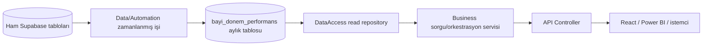
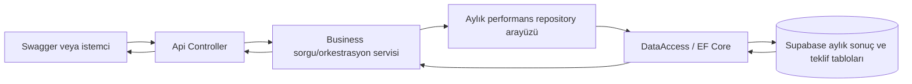

# Bayi Performans Web API

Bu repository, bayi performans ve karar destek API'sinin .NET 8 ile hazırlanmış
N-tier (çok katmanlı) solution'ıdır.

API'nin Render + Redis production hazırlığı ve gerekli ortam değişkenleri için
[canlıya alma rehberine](docs/CANLIYA_ALMA_RENDER.md) bakın. React/Vercel yayını
UI sahibinin ayrı teslimatıdır.

## Mevcut durum

Yazılım-1 kapsamında aşağıdaki parçalar hazırdır:

- Kimlik, aylık performans, katalog, stok ve teklif endpointleri ile
  request/response DTO'ları
- Swagger/OpenAPI ve standart hata cevapları
- `appsettings` + `IOptions` konfigürasyonu
- EF Core ile Supabase PostgreSQL erişim altyapısı ve mapping'ler
- Altı ham tablo için read repository'ler; bayi, ürün, stok ve teklifler için sınırlı write repository'ler
- API, Business, DataAccess ve Entities proje sınırları

Yazılım-2'nin mevcut deterministik hesaplayıcıları, Business servisleri ve DI
kayıtları API'ye bağlıdır. 25 Ağustos 2026 tarihli kesin veri sözleşmesinde
performans/risk hesaplarını Data ve Automation üretip Supabase'deki aylık
`bayi_donem_performans` tablosuna yazar; yeni performans endpointleri bu hazır
sonuçları salt okunur sunar. Mevcut hesaplayıcılar karşılaştırma ve regresyon
amacıyla korunur; yeni performans endpointlerinin çalışma yolu değildir.

İş endpointleri token olmadan `401` döner. Canlı Supabase doğrulaması yalnız
yerel User Secret güncellendikten sonra yapılır. Geçici fallback kayıtları
güvenlik ağı olarak kalır ancak gerçek servisleri ezmez.

## Aylık performans mimarisi



Hedef davranış:

- Data/Automation aylık deterministik metrikleri ve gerekçe kodlarını hesaplar.
- API istek sırasında ciro, marj, risk veya kritik stok hesabı yapmaz.
- API istenen dönem için `(bayi_kodu, donem)` anahtarlı kaydı okur. Kayıt yoksa eski
  hesaplayıcıya veya mock veriye düşmez; tanımlanacak kontrollü hata/boş sonuç
  sözleşmesini uygular.
- Aylık performans tablosunda snapshot tarihi, run ID, karar veya AI yorumu
  tutulmaz. Teklif değerlendirmesi ve AI yorumu kendi normalize tablolarındadır.

## Solution yapısı

```text
BayiPerformansAppWeb.sln
├── BayiPerformansAppWeb.Api
│   ├── Controllers
│   ├── Contracts
│   ├── Configuration
│   ├── Integration
│   └── Validation
├── BayiPerformansAppWeb.Business
│   ├── Abstractions
│   ├── Calculations
│   ├── Configuration
│   ├── Models
│   └── Services
├── BayiPerformansAppWeb.Business.Tests
├── BayiPerformansAppWeb.Api.Tests
├── BayiPerformansAppWeb.DataAccess
│   ├── Abstractions
│   ├── Configuration
│   ├── Persistence
│   └── Repositories
├── BayiPerformansAppWeb.Entities
└── docs
```



Katman kuralları:

- `Api`, HTTP isteklerini alır ve Business servisini çağırır.
- `Business`, hesaplanmış sonucu sorgular, eksik/veri durumu sözleşmesini
  uygular ve API çıktısını orkestre eder.
- `DataAccess`, PostgreSQL aylık performans verisini okur ve yetkili yönetim
  işlemlerinde sınırlı yazma yapar.
- `Entities`, katmanlar arasında taşınan veri modellerini içerir.
- Controller doğrudan `DbContext` veya repository çağırmaz.
- Business, Api projesine referans vermez.
- Yeni performans okuma yolunda Business ve DataAccess metrik veya risk skoru hesaplamaz.

## VS Code ile açma

Terminal kullanmak zorunlu değildir. Bilgisayarda VS Code, .NET 8 SDK ve önerilen
**C# Dev Kit** eklentisi bulunmalıdır. Kök `global.json` solution'ın .NET 8 SDK
ile açılmasını sağlar.

1. VS Code'u aç.
2. **File > Open Folder** ile repository kökü olan `BayiPerformansAppWeb`
   klasörünü aç. Yalnız `Api` alt klasörünü açma.
3. Eklenti önerisi görünürse **C# Dev Kit** kurulumunu kabul et.
4. Sol taraftaki **Solution Explorer** içinde `BayiPerformansAppWeb.sln` ve dört
   projeyi gördüğünü kontrol et.
5. **Run and Debug** ekranını aç.
6. Üst listeden **BayiPerformans API (.NET 8)** seç.
7. `F5` tuşuna bas.

`.vscode/tasks.json` Docker'daki yerel Redis'i başlatmak ve solution'ı derlemek
için ayrı görevler sunar. `.vscode/launch.json` API'yi
Development ortamında HTTPS `https://localhost:7000` ve HTTP
`http://localhost:5000` adreslerinde başlatır. HTTP istekleri HTTPS'e
yönlendirilir; Swagger hazır olduğunda otomatik açılır. Bütün projeler `.NET 8.0`
hedefler.

## Supabase bağlantısını ekrandan tanımlama

Gerçek bağlantı dizesi Git'e, `appsettings.json` dosyasına, README'ye veya
sohbete yazılmaz.

VS Code'da **Solution Explorer** içindeki `BayiPerformansAppWeb.Api` projesine
sağ tıkla ve **Manage User Secrets** seç. Açılan dosyada `CHANGE_ME` içeren yerel
bağlantı dizesini kendi Supabase bağlantınla değiştir.

Bu menü görünmezse **File > Open File** ile aşağıdaki dosyayı aç. Windows'taki
konumu projenin `UserSecretsId` değeri belirler:

```text
%APPDATA%\Microsoft\UserSecrets\bayi-performans-app-web-api\secrets.json
```

Yer tutucuları yalnız kendi bilgisayarında gerçek değerlerle değiştir.

```json
{
  "Database": {
    "ConnectionString": "Host=<SUPABASE_TRANSACTION_POOLER_HOST>;Port=6543;Database=postgres;Username=<APP_DB_USER>;Password=<PASSWORD>;SSL Mode=VerifyFull;Root Certificate=<LOCAL_ABSOLUTE_CA_PATH>",
    "MaximumPoolSize": 5,
    "MinimumPoolSize": 0,
    "ConnectionIdleLifetimeSeconds": 60
  },
  "SupabaseAuth": {
    "ProjectUrl": "https://<PROJECT_REF>.supabase.co",
    "PublishableKey": "<SB_PUBLISHABLE_KEY>"
  }
}
```

User Secrets repo klasörünün dışındadır ve Git'e eklenmez; fakat şifreli bir kasa
değildir. İçeriğini, ekran görüntüsünü veya `user-secrets list` çıktısını paylaşma.
Yalnız gerekli tablo ve view'larda `SELECT`; bayi, ürün, stok ve teklif yönetimi
için yalnız ilgili tablolarda gerekli `INSERT/UPDATE` yetkileri olan PostgreSQL
rolü kullan.

`VerifyFull`, sunucu sertifikasını ve host adını doğrular. Supabase Dashboard'da
**Database > Settings > SSL Configuration** bölümünden indirilen Root CA dosyasını
repo dışında tut ve `Root Certificate` alanına o bilgisayardaki mutlak yolu yaz.
Sertifika yolu her bilgisayarda farklı olabileceği için `appsettings.json` içine
konmaz. `TrustServerCertificate=true` kullanma; bu doğrulamayı devre dışı bırakır.

Bağlantı dizesi boş veya geçersizse uygulama güvenlik amacıyla başlangıçta durur;
Root CA dosyası bulunamazsa da Swagger açılmaz. Önce User Secret'ı veya yerel
sertifika yolunu düzeltmek gerekir.

`PublishableKey` için yalnız `sb_publishable_` ile başlayan public anahtar
kullanılır. `sb_secret`, `service_role`, JWT signing secret veya DB parolası bu
alana konmaz. Ayrıntılar [kimlik doğrulama rehberindedir](./docs/KIMLIK_DOGRULAMA.md).

## Redis ve e-posta OTP kurulumu

Login için kullanıcı ilk olarak `/auth/login` endpointine e-posta ve şifresini
gönderir. Supabase parola kontrolü başarılıysa API 6 haneli kod üretir, kodun
yalnız hash'ini TTL ile Redis'te saklar ve gerçek kodu Brevo HTTPS API üzerinden e-postaya
yollar. Yanlış parolada OTP gönderilmez. Doğrudan `/auth/otp/gonder` ile
`LOGIN_2FA` amaçlı kod başlatılması reddedilir.
Redis kapalıysa uygulama geliştirme kolaylığı için süreç içi belleğe düşebilir;
mentor demosunda gerçek Redis akışını göstermek için Docker Desktop açık olmalıdır.

Terminal kullanmadan çalıştırmak için Docker Desktop'ı açtıktan sonra VS Code'da
**Terminal > Run Task > BayiPerformans: API icin hazirla** seçilebilir. Bu görev
Redis'i başlatıp solution'ı derler; ardından `F5` ile API açılır. Docker henüz
kurulu değilken normal `F5` geliştirme akışını bozmaz ve mevcut in-memory fallback
kullanılabilir. İsteğe bağlı Redis Commander ekranı için
`docker compose --profile tools up -d` çalıştırıldığında `http://localhost:8081`
açılır; normal OTP kullanımı için bu ekran gerekli değildir.

Brevo panelinde bir gönderici e-posta adresi ekle ve adrese gelen 6 haneli kodla
doğrula. Ardından transactional e-posta API anahtarı oluştur. Aşağıdaki alanları
mevcut User Secrets JSON'una ekle; gerçek anahtarı sohbete, Git'e, UI'a veya
ekran görüntüsüne koyma:

```json
{
  "BrevoEmail": {
    "Enabled": true,
    "ApiKey": "<BREVO_API_KEY>",
    "FromEmail": "<VERIFIED_BREVO_SENDER_EMAIL>",
    "FromName": "Bayi Performans",
    "TimeoutSeconds": 15
  }
}
```

User Secrets tek bir JSON nesnesidir; bu bölüm `Database` ve `SupabaseAuth`
bölümlerinin yanına eklenir, ikinci bir kök `{}` oluşturulmaz. Brevo kapalıysa
veya gönderim başarısızsa endpoint sahte başarı üretmez; kontrollü
`503 OTP_EPOSTA_GONDERILEMEDI` döner ve kullanılmayan OTP/cooldown kaydı temizlenir.
Başarılı gönderimde OTP kodu API yanıtına veya loglara yazılmaz.

Login sırası şöyledir:

1. `POST /auth/login`: e-posta + şifre; başarılı parola kontrolünden sonra
   `202` ve `islem_id` döner, OTP e-postaya gönderilir.
2. `POST /auth/otp/dogrula`: `islem_id` + 6 haneli kod; kısa ömürlü
   `dogrulama_token` döner.
3. `POST /auth/login`: aynı e-posta + şifre + `dogrulama_token`; token atomik
   olarak tüketilir ve Supabase access/refresh token çifti döner.

Doğrulama kanıtının yalnız hash'i saklanır; süresi dolan, başka e-postaya
ait veya daha önce kullanılmış kanıt tekrar kabul edilmez.

## Elasticsearch ve Kibana yerel kurulumu

`docker-compose.yml`, Redis'e ek olarak isteğe bağlı bir `search` profili içerir:

- Elasticsearch `8.12.1`: `http://localhost:9200`
- Kibana `8.12.1`: `http://localhost:5601`
- Kalıcı Docker volume: `elasticsearch_data`
- Airflow'un dışarıdan bağlanabileceği sabit ağ: `elastic_migration_elastic_net`
- Başlangıç indexi: `satislar_index`

Terminal komutu yazmadan çalıştırmak için Docker Desktop açıkken VS Code'da
**Terminal > Run Task > BayiPerformans: API ve arama icin hazirla** seç. Bu görev
Redis, Elasticsearch, index hazırlama servisi ve Kibana'yı başlatıp solution'ı
derler. Yalnız arama altyapısını açmak veya kapatmak için ilgili
**Elasticsearch ve Kibana baslat/durdur** görevleri kullanılabilir.

Development ortamında API Elasticsearch sağlık kontrolünü etkinleştirir.
`GET /health` yalnız uygulamanın ayakta olduğunu bildirir. Bağımlılıkların
durumu `GET /health/ready` üzerinden izlenir: cluster erişilemiyorsa `503`,
cluster erişilebilir fakat `satislar_index` yoksa `Degraded`, ikisi de hazırsa
`Healthy` döndürür. Aynı readiness endpointi PostgreSQL ve Redis'i de kontrol
eder. Uygulamanın ana endpointleri Elasticsearch kapalıyken çalışmaya devam
eder.

JWT ile korunan `GET /api/v1/satis/arama` endpointi Elasticsearch'teki satış
belgelerinde salt-okunur arama yapar. `q` (3-100 karakter), tarih aralığı,
`bayi_kodu`, `urun_kodu`, `depo_kodu`, `bolge`, `segment`, `sayfa` ve
`sayfa_boyutu` filtrelerini destekler. Yanıt toplam kayıt sayısını ve sayfalı
satış kayıtlarını döndürür; satış veya performans hesabı yapmaz. Elasticsearch
kapalıysa ya da index hazır değilse hata boş listeye çevrilmez, açıklayıcı bir
`503` cevabı döner.

Index mapping'i
[`elastic_migration/index_mapping.json`](./elastic_migration/index_mapping.json)
dosyasındadır. Türkçe küçük harf dönüşümü, ASCII folding ve 3-5 karakter
N-Gram araması içerir. Bu Compose ayarlarında kimlik doğrulama yalnız yerel
geliştirme kolaylığı için kapalıdır; internete açık veya production ortamında
kullanılmamalıdır.

Bu aşama Elasticsearch/Kibana altyapısını ve index sözleşmesini hazırlar.
Supabase'den veriyi okuyup Bulk UPSERT yapan `sync_to_elastic.py` ve onu
tetikleyen Airflow DAG'ı Data/ETL-Automation ekibinin teslimatıdır. Bu aktarım
gelmeden index boş olabilir; altyapının çalışması veri senkronizasyonunun
tamamlandığı anlamına gelmez.

Production ortamında aramanın açılması için güvenli bir Elasticsearch hizmeti
ve API anahtarı gerekir. Render'da `Elasticsearch__Enabled=true`,
`Elasticsearch__Url`, `Elasticsearch__IndexName=satislar_index` ve
`Elasticsearch__ApiKey` tanımlanmadan canlı arama etkinleştirilmemelidir.

## Çalıştırma

VS Code'da **Run and Debug > BayiPerformans API (.NET 8)** seçip `F5` kullan.
Tarayıcıda şu adres otomatik açılır:

```text
https://localhost:7000/swagger
```

Uygulama kapanana kadar VS Code debug oturumu açık kalır. Durdurmak için debug
araç çubuğundaki kırmızı durdurma düğmesini kullan.

Kimlik testlerini terminal komutu yazmadan çalıştırmak için VS Code'da
**Terminal > Run Task > BayiPerformans: API auth testleri** seç. API ve Business
test projeleri solution'a dahildir; solution genelindeki test komutu iki test
projesini de çalıştırır.

## Temel iş endpointleri

| Yöntem ve adres | Amaç |
|---|---|
| `GET /bayi/{kod}/performans?donem=YYYY-MM` | Tek bayinin dönem performansı |
| `GET /bayiler/risk-listesi?donem=YYYY-MM&segment=...&bolge=...` | Dönemsel bayi risk listesi |
| `GET /stok/kritik?depo_kodu=...&urun_kodu=...` | Kritik stok listesi |
| `POST /teklifler` | Birden fazla ürün kalemi içeren taslak teklif oluşturur |
| `GET /teklifler?bayi_kodu=...&sehir=...&bolge=...&durum=...` | Teklifleri bayi, il, bölge, durum ve tarih aralığıyla listeler |
| `GET /teklifler/{id}` | Kalemleri ve varsa değerlendirme sonucuyla teklifi getirir |
| `POST /teklifler/{id}/degerlendir` | Daha önce kaydedilmiş teklifi deterministik karar motorunda değerlendirir |

UI seçim alanlarının canlı veritabanından doğrudan doldurulması için ayrıca şu
katalog endpointleri bulunur:

| Yöntem ve adres | Amaç |
|---|---|
| `GET /bayiler?segment=...&bolge=...` | Bayi listesini ve isteğe bağlı filtreleri döndürür |
| `GET /depolar` | Tanımlı depoları döndürür |

Çok kalemli teklif oluşturma örneği:

```json
{
  "bayi_kodu": "B0012",
  "aciklama": "Ağustos kampanya teklifi",
  "kalemler": [
    {
      "urun_kodu": "U1002",
      "depo_kodu": "DP01",
      "miktar": 8,
      "birim_fiyat": 18000,
      "iskonto_orani": 0.05
    },
    {
      "urun_kodu": "U1057",
      "depo_kodu": "DP06",
      "miktar": 3,
      "birim_fiyat": 9500,
      "iskonto_orani": 0.1
    }
  ]
}
```

`iskonto_orani` yüzde değil, `0–1` arası orandır. `%5` için `0.05` gönderilir.
Eski tek-adımlı `POST /teklif-degerlendir` geriye dönük uyumluluk için kodda
kalır ancak Swagger'da gösterilmez. Yeni UI tek butonda
`POST /api/v1/teklifler/olustur-ve-degerlendir` çağırır; API kayıt ve
değerlendirme adımlarını aynı `teklif_id` üzerinde sırayla yürütür.

Günlük hesaplama .NET API prosesi içinde on-demand veya background service olarak
çalıştırılmayacaktır. Data/Automation zamanlayıcısı işi yürütüp sonucu ve çalışma
durumunu PostgreSQL'e yazmalıdır. `GET /jobs/gece-batch` ve
`GET /jobs/skor-hesapla` hedef mimaride yalnız bu harici işin son durumunu okur;
hesaplamayı başlatmaz. Mevcut API background service'i geçiş kodudur ve günlük
job sözleşmesi bağlandıktan sonra devre dışı bırakılmalı veya kaldırılmalıdır.

## HTTP cevapları

| Kod | Anlamı |
|---|---|
| `200` | İstenen aylık sonuç başarıyla okundu |
| `400` | İstek alanlarından biri geçersiz |
| `404` | İstenen bayi, ürün veya depo bulunamadı |
| `409` | İstek mevcut iş/veri durumuyla çakışıyor |
| `503` | Bağımlı bir servis geçici olarak kullanılamıyor veya entegrasyon kaydı eksik |
| `500` | Beklenmeyen uygulama veya altyapı hatası |

Hatalar `ProblemDetails` biçiminde ve `hata_kodu` ile `trace_id` alanlarıyla
döner. JSON alanları `snake_case` biçimindedir.

## Veri erişimi

EF Core bugün şu ham tabloları ve işlem tablolarını sorgular:

- `bayiler`
- `depolar`
- `hedefler`
- `satis`
- `stok`
- `urunler`
- `bayi_donem_performans`
- `teklifler`
- `teklif_kalemleri`
- `teklif_degerlendirme`
- `teklif_ai_yorumlari`

Persistence eşlemeleri mevcut tablo anahtarlarını tanımlar ve migration dışıdır.
Read repository'ler varsayılan olarak `NoTracking` çalışır. Bayi, ürün, stok ve
teklif yönetim endpointleri write repository üzerinden sınırlı `INSERT/UPDATE`
yapar.
Uygulama Supabase'de tablo oluşturmaz; `EnsureCreated` veya `Migrate`
çalıştırmaz.

Kesin şema migration'ı repository kökündeki
`supabase/migrations/20260825000001_refactor_schema_and_tables.sql`
dosyasındadır. Uygulama bunu otomatik çalıştırmaz; Data/Supabase sorumlusu
inceleyip hedef projede uygular.

Data ekibinin view'ları ileride seçici olarak kullanılabilir. Ham tablo
repository'leri kaldırılmaz; view'ın mevcut olması içindeki hedef/iade/risk
formülünün PO tarafından onaylandığı anlamına gelmez.

`bayi_donem_performans` mapping'i kesin aylık kolonlara ve
`(bayi_kodu, donem)` anahtarına bağlıdır. Teklif mapping'i dört normalize tabloyu
birlikte okur; bayi/ürün/depo açıklamalarını master tablolardan tamamlar.

## Ekip sorumlulukları

### Yazılım-1

- Controller, endpoint ve DTO sözleşmeleri
- HTTP doğrulaması ve standart hata cevapları
- EF Core, Npgsql ve Supabase veri erişimi
- Repository ve persistence eşlemeleri
- Bağlantı/CORS konfigürasyonu
- Swagger ve teknik dokümantasyon

### Yazılım-2

- Aylık hesaplanmış tabloları tüketen sorgu/orkestrasyon servisleri
- Eksik veya gecikmiş aylık kayıt davranışı
- Veri modellerinin API çıktı sözleşmesine dönüşümü
- Geçiş süresinde Data/Automation sonuçlarını eski deterministik test sonuçlarıyla karşılaştırma
- Business servis testleri ve DI kaydı

Eski hesaplama motoru için hazırlanmış
[Yazılım-2 Business yol haritası](./docs/YAZILIM_2_YOL_HARITASI.md) tarihsel
referanstır; aylık hazır veri kararı bu belgedeki runtime hesaplama adımlarının
yerini almıştır.

### Data/Automation

- Ham veriden aylık deterministik metrikleri üretmek
- Tekrarlanabilir biçimde `(bayi_kodu, donem)` kaydını üretmek/güncellemek
- Formül/eşik değişikliğini sürümlemek ve PO onaylı sözleşmeyi uygulamak
- API'nin ihtiyaç duyduğu indeks/unique anahtar gereksinimlerini Data ekibiyle uygulamak

### AI/Automation

AI, teklif metinlerini `teklif_ai_yorumlari` tablosuna yazar. Performans
tablosundaki `risk_skoru`, `risk_seviyesi` veya `gerekce_kodlari` değerlerini
değiştirmez. AI çalışmasa bile deterministik performans ve teklif kayıtları
geçerlidir; API yorum alanlarını `null` dönebilir.

## Açık PO kararları

Kodlamadan önce aşağıdakiler yazılı olarak kesinleştirilmelidir:

- Hedefsiz bayinin risk skoruna etkisi
- İade oranının kesin formülü ve iadelerin marja etkisi
- Kritik stokta `<` veya `<=` seçimi
- Marj, iskonto ve risk eşikleri
- Gerekçe kodlarının sabit listesi
- `donem` verilmediğinde seçilecek varsayılan dönem
- Yuvarlama ve yüzde gösterim kuralları
- Zamanlanmış işin çalışma saati, zaman dilimi ve geç kalma toleransı
- Aylık kayıt bulunmadığında 404, 204 veya son dönemi kullanma kararı

Yazılım-1 bu kararları tahmin edip controller veya repository içine yazmaz.

## Güvenli Git akışı

- Her stajyer kendi branch'inde çalışır.
- `master` üzerine doğrudan commit veya push yapılmaz.
- `git add .` yerine amaçlanan dosyalar seçilir.
- `.env`, `secrets.json`, parola veya gerçek connection string commit edilmez.
- Ortak snapshot `penta-intern-project` içindeki entegrasyon dalından incelenir;
  yeni işler bu dal veya güncel `main` tabanından kişisel feature branch'ine alınır.
- Birleşme, dosya kopyalamak yerine PR/branch üzerinden yapılır.

Bu şema uyarlamasının kişisel inceleme branch'i:

```text
yusuf/software1-schema-refactor
```

## Kayıt ve giriş

Supabase Auth tabanlı e-posta/şifre kaydı, login ve JWT doğrulama akışı için
[kimlik doğrulama rehberine](./docs/KIMLIK_DOGRULAMA.md) bak.
